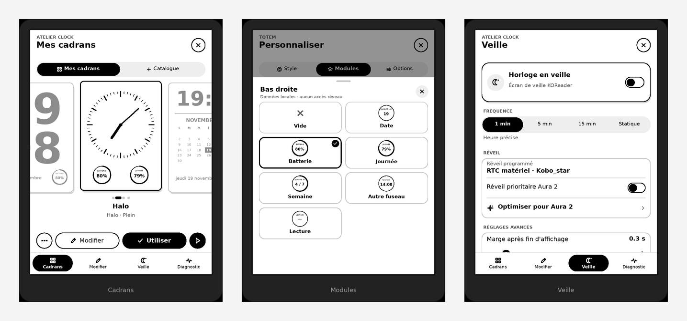
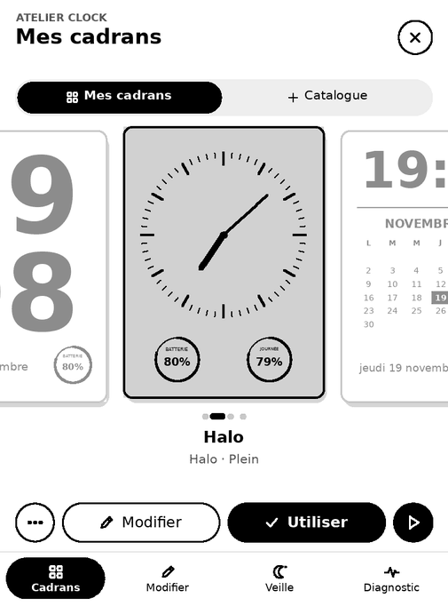
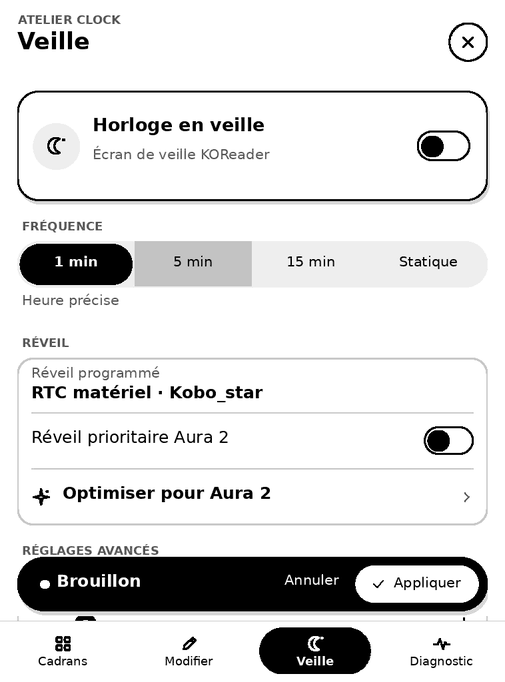
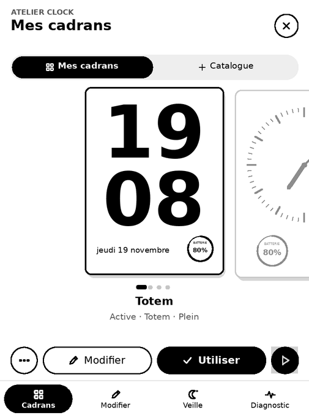
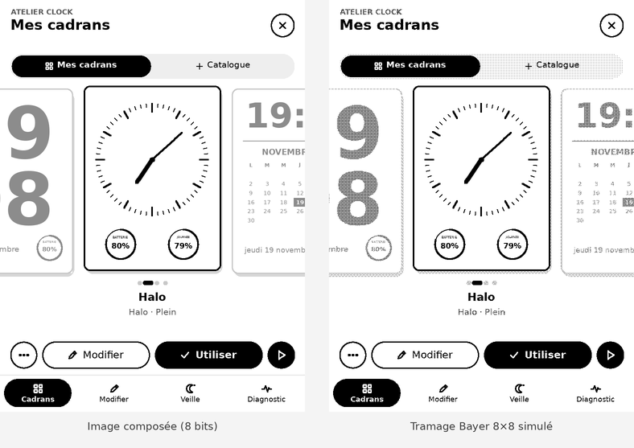
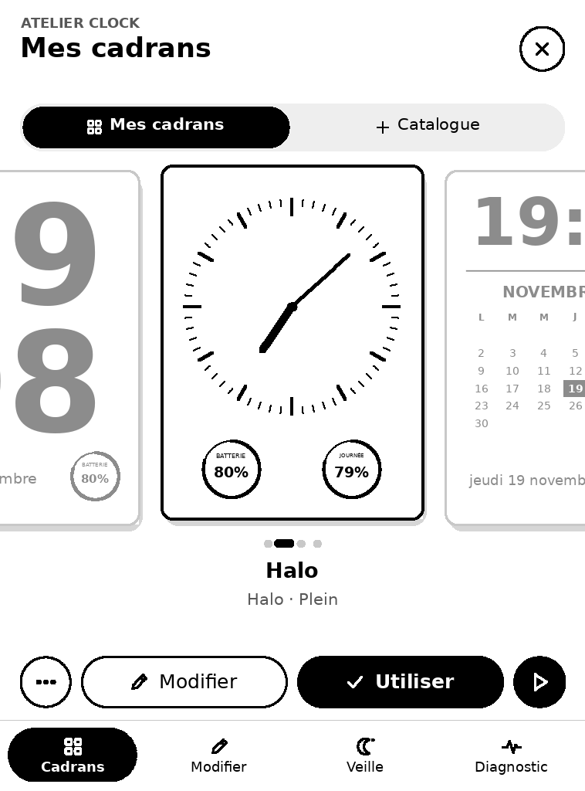
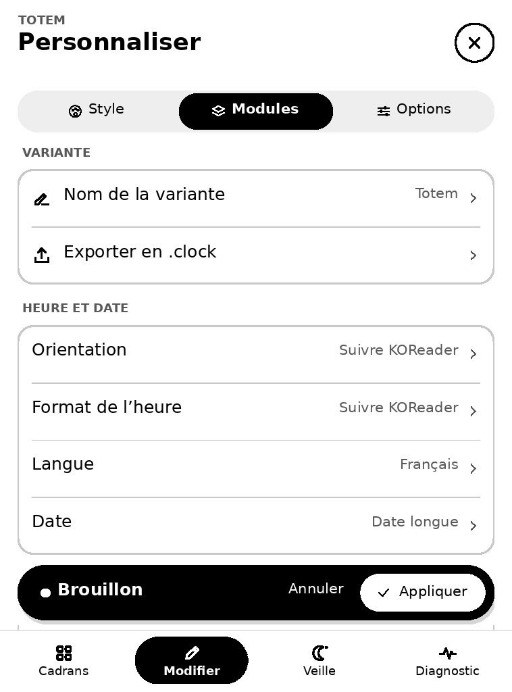
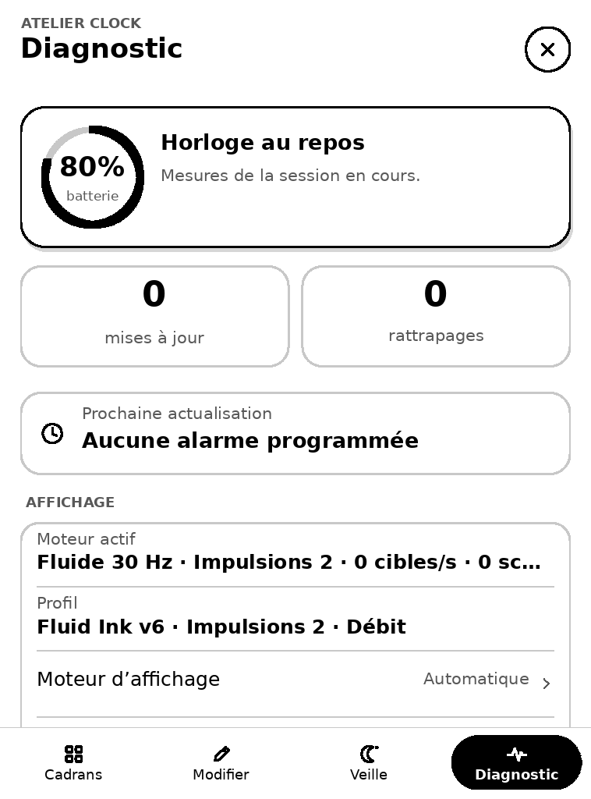
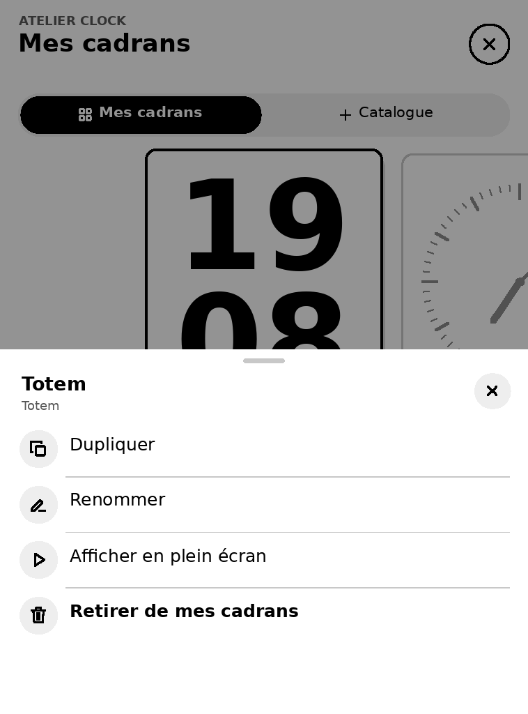
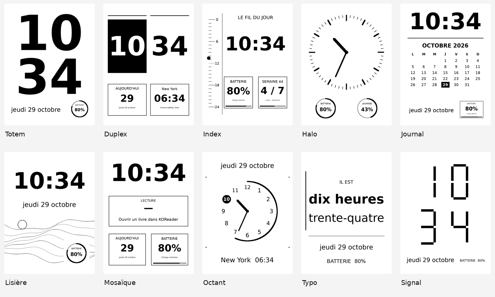

# Atelier Clock

**Horloges de veille pour KOReader, avec un atelier plein écran pensé pour une liseuse qui ne rafraîchit plus à 2–3 Hz mais à 30 Hz.**

Version **0.3.0 « Fluide »** — 19 novembre 2026 · [Journal des changements](CHANGELOG.md) · [English summary](#english-summary)



Atelier Clock affiche une horloge pendant la veille de la liseuse, réveillée chaque minute par le RTC, et propose un atelier pour choisir, composer et régler dix cadrans. La version 0.3.0 refond toute l'interface autour du moteur **Fluid Ink v6.5**. Sur une **Kobo Aura Edition 2 v1**, le moteur vise **30 images par seconde** avec le profil **Impulsions 2** et le réglage **Débit**. Le défilement suit le doigt avec de l'inertie, les écrans glissent, les feuilles montent du bas et les interrupteurs basculent avec un petit rebond, comme sur un téléphone. Les autres liseuses compatibles avec Fluid Ink utilisent **Fluid Ink v6 sans impulsions**. Toutes les autres utilisent l'affichage classique de KOReader, avec exactement les mêmes écrans et fonctions, sans animation.

## Voir l'interface bouger

Chaque image ci-dessous est une vraie image produite par le code du plugin, à 30 Hz, telle qu'elle serait transmise au moteur (outil `tools/build_screenshots.py`, polices DejaVu de substitution). Ce ne sont pas des vidéos de la dalle e-ink.

| Carrousel inertiel | Onglets et compteurs |
| :---: | :---: |
|  |  |
| **Modules : feuille et cadre volant** | **Réglages : segments, défilement élastique, brouillon** |
|  |  |

| « Afficher » : l'aperçu grandit jusqu'à l'horloge | Ce que voit la dalle : tramage Bayer 8×8 (simulation) |
| :---: | :---: |
|  |  |

## Les écrans

| Cadrans | Catalogue | Modules | Style |
| :---: | :---: | :---: | :---: |
|  |  |  |  |
| **Options** | **Veille** | **Diagnostic** | **Actions** |
|  |  |  |  |



## Ce qui change en 0.3.0

- **Une interface entièrement redessinée** à la main : cartes à coins doux, boutons en pilule, contrôles segmentés à pastille glissante, interrupteurs animés et 38 icônes vectorielles à trait arrondi. Le noir plein est réservé à l'action principale.
- **Des listes qui défilent** au lieu de pages numérotées. Le défilement est inertiel, avec un bord élastique, et le doigt arrête l'élan immédiatement.
- **Un carrousel de cadrans** : glisser, lancer, accrocher. Les cadrans voisins dépassent sur les bords et s'estompent avec la distance.
- **Des feuilles qui montent du bas** pour les modules, les choix, les actions (⋯) et les confirmations. Elles remplacent les fenêtres de KOReader, se ferment d'un geste vers le bas et ne rendent pas la main à KOReader.
- **Un brouillon visible** : la barre *Brouillon · Annuler · Appliquer* n'apparaît que s'il y a quelque chose à appliquer. Les messages s'affichent en notifications brèves.
- **« Afficher » ouvre l'horloge par un zoom** depuis l'aperçu.
- **Moteur Fluid Ink 6.5 intégré**, avec un profil choisi automatiquement selon la liseuse (tableau ci-dessous) et un repli propre. **Diagnostic → Affichage** indique le moteur actif et ses cadences en direct.
- **Le RTC vérifié sur chaque liseuse compatible** : 7 Kobo et 3 Kindle. La prise en charge des Kindle (réveil via powerd) est nouvelle.
- **Aucune fonction retirée.** La liste écran par écran est dans [docs/FONCTIONS.md](docs/FONCTIONS.md).

## Moteur d'affichage

| Liseuse | Profil | Réglage |
|---|---|---|
| **Kobo Aura Edition 2 v1** (`Kobo_star`) | **Fluide 30 Hz · Impulsions 2** | Fluid Ink v6, 2 impulsions, **Débit** (file 1, Bayer 8×8, sans gamma), A2, 30 ips ciblées |
| Kobo Aura 2 v2, Aura H2O 2 v1/v2, Glo HD, Aura One, Clara HD, Kindle Paperwhite 2/3, Voyage | **Fluide v6 · sans impulsions** | Mode constructeur : A2 en mouvement, DU au repos, profil Débit |
| Aura 2 v1 dont les impulsions sont refusées | **Fluide v6 · sans impulsions** | Fluid Ink v6, repli signalé dans le Diagnostic |
| Toute autre liseuse, ou si la vérification échoue | **Classique KOReader** | Mêmes écrans, animations remplacées par leur état final |

Comment ça marche :

- L'atelier compose chaque image en niveaux de gris 8 bits à partir de couches gardées en mémoire (en-tête, contenu défilant, cartes, feuilles), puis la transmet au moteur.
- Le moteur tourne dans un processus séparé, après une vérification en mémoire (sans toucher à l'écran), et reste le seul à écrire sur l'écran tant qu'il est actif.
- Pour la saisie de texte (nom, chemin d'import ou d'export), il s'arrête, restaure la table d'origine et rend l'écran à KOReader, puis reprend. Le premier affichage après la reprise peut provoquer un flash GC16.
- Avant chaque veille, le moteur est arrêté de façon synchrone : l'horloge de veille garde son chemin d'énergie habituel et n'utilise jamais Fluid Ink.

Réglages dans **Diagnostic → Affichage** :

| Réglage | Valeurs |
|---|---|
| Moteur | Automatique, Fluide ou Classique |
| Cadence cible | 30, 45 ou 60 Hz |
| Nettoyage au repos | Rafraîchissement constructeur du moteur pendant les pauses |
| Animations | Complètes ou Réduites |

On y trouve aussi les actions **Nettoyer l'écran** et **Réessayer le moteur fluide**.

> **Impulsions 2 sur l'Aura 2 v1.** Le profil à impulsions a besoin de la copie de waveform `factory-reference.bin` de **votre** liseuse. Il s'agit d'un fichier constructeur personnel : ce dépôt ne le redistribue pas. Copiez-le depuis votre paquet Fluid Ink 6.5 (`inkmotion.koplugin/factory-reference.bin`) vers `atelierclock.koplugin/engine/fluidink/`. Sans ce fichier, l'Aura 2 v1 passe automatiquement en **Fluide v6 · sans impulsions**.

La fluidité réelle, le contraste et les traces se mesurent sur la dalle (voir `third_party/fluid-ink/PROTOCOLE_30HZ.md`). Les compteurs du Diagnostic indiquent les images soumises et les scans confirmés, pas une cadence optique.

## Réveil RTC selon la liseuse

| Liseuse | Réveil | Remarques |
|---|---|---|
| Kobo : `Kobo_star`, `Kobo_star_r2`, `Kobo_snow`, `Kobo_snow_r2`, `Kobo_alyssum`, `Kobo_daylight`, `Kobo_nova` | RTC matériel (`WakeupMgr`), suspension gérée par KOReader | Les optimisations Aura 2 (réveil prioritaire, réutilisation de la préparation, veille FP9928) restent réservées aux modèles déjà ciblés. Sur un RTC i.MX5, la chaîne d'alarmes d'une longue pause est nettoyée à l'arrêt. |
| Kindle Paperwhite 2/3, Voyage | `WakeupMgr` + `mockrtc` via powerd | Nécessite l'écran de veille de KOReader (Kindle sans offres spéciales). powerd suspend la liseuse lui-même. Un garde rattrape la minute si la liseuse est restée éveillée, ou si une alarme passée a été supprimée. Précision d'environ 15 s : 5 minutes sont conseillées. |
| Sans `WakeupMgr` | Aucun | Horloge figée à l'endormissement, avec un message explicite. |

Ces comportements sont testés avec le vrai code de KOReader (`wakeupmgr.lua`, `kindle/mockrtc.lua`, fonctions de réveil de `kindle/powerd.lua`), épinglé à un commit précis. Ils n'ont pas été mesurés sur appareil.

## Installation

1. Quitter KOReader.
2. Copier le dossier **`atelierclock.koplugin`** dans `koreader/plugins/`. Sur Kobo, c'est généralement `.adds/koreader/plugins/`. Lors d'une mise à jour, **remplacer** le dossier entier plutôt que de fusionner. Conserver `settings/atelierclock`, qui contient vos réglages et vos imports.
3. Aura 2 v1 : ajouter `factory-reference.bin` comme indiqué plus haut.
4. Relancer KOReader et ouvrir **Outils → Plus d'outils → Atelier Clock**.
5. Dans **Veille**, activer *Horloge en veille*. L'option **Horloge Atelier** apparaît aussi dans le menu d'écran de veille de KOReader.

Pour lancer l'horloge à la main, utiliser **Afficher** (ou l'action Dispatcher *Atelier Clock : afficher*). Un toucher la ferme, un appui long ouvre l'atelier. Les cadrans `.clock` v1 et v2 s'importent depuis le **Catalogue**, et chaque variante s'exporte depuis **Modifier → Options**.

## Développement

Le guide est dans [DEVELOPPEMENT.md](DEVELOPPEMENT.md). En résumé :

```bash
python -m pip install -r requirements-test.txt
```

```bash
python tools/fetch_test_dependencies.py
```

```bash
PYTHONPATH=tests python -m unittest discover -s tests -p 'test_*.py'
```

```bash
PYTHONPATH=tests python tools/build_screenshots.py
```

La suite compte **168 tests** : rendu, énergie, RTC sur les 10 modèles, moteur Fluid simulé et animations à horloge déterministe. Le validateur de plugin KOReader ne signale aucune erreur.

## Licences

- **Code d'Atelier Clock** : MIT.
- **Cadrans et textures** : CC0.
- **Moteur Fluid Ink** (`engine/fluidink`) : ses en-têtes indiquent GPL-3.0-or-later, et son paquet est livré avec le texte de l'AGPL-3.0. Ses sources natives sont dans `third_party/fluid-ink`.
- **Le plugin distribué dans son ensemble** suit le fichier [LICENSE](LICENSE) (AGPL-3.0, comme ce dépôt auparavant).

Le détail figure dans `atelierclock.koplugin/LICENSE`.

---

## English summary

Atelier Clock is a KOReader screensaver clock (RTC wake-up every minute, ten `.clock` faces, complications) with a full-screen editor.

Version 0.3.0 redesigns the whole interface for the **Fluid Ink 6.5** engine. On a **Kobo Aura Edition 2 v1** it uses *Fluid Ink v6 · Impulsions 2 · Débit* (30 fps target), and other Fluid-compatible readers use *Fluid Ink v6 without pulses*. The interface has inertial scrolling, a snapping carousel, bottom sheets, gliding segmented controls, animated switches and a zoom into the clock. Every other device falls back to classic KOReader refreshes with identical screens and no animation.

RTC wake-ups are checked for all 7 Fluid-compatible Kobo models (hardware RTC) and the Kindle PW2/PW3/Voyage (powerd + mockrtc, about 15 s precision).

Nothing was removed; see [docs/FONCTIONS.md](docs/FONCTIONS.md) and the [CHANGELOG](CHANGELOG.md).

The personal vendor waveform `factory-reference.bin` needed for pulses is **not** redistributed: copy it from your own Fluid Ink package. Optical cadence and ghosting were not measured on hardware.
