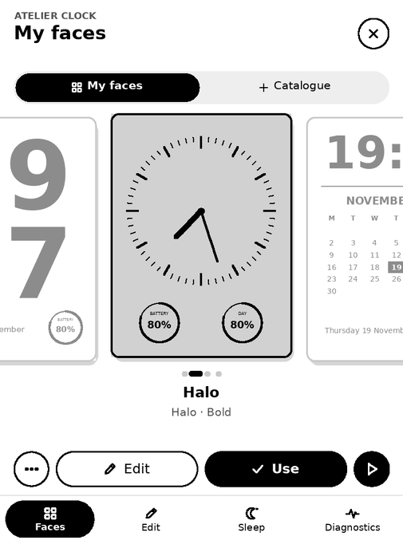
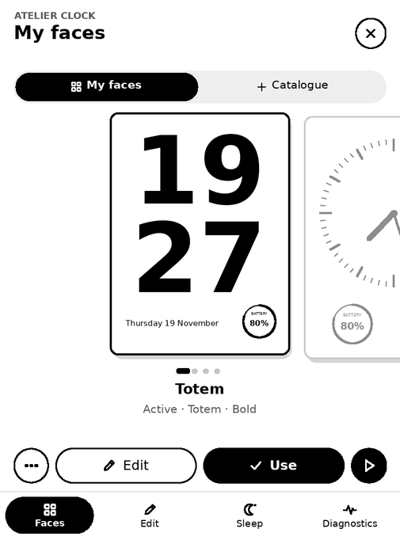
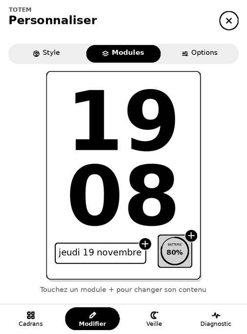
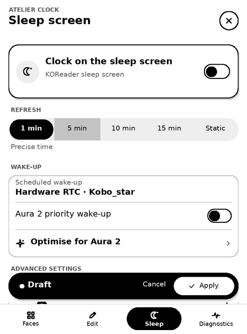
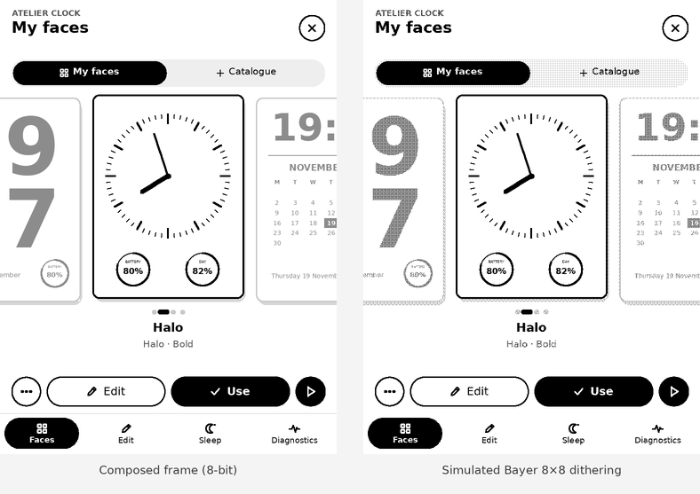
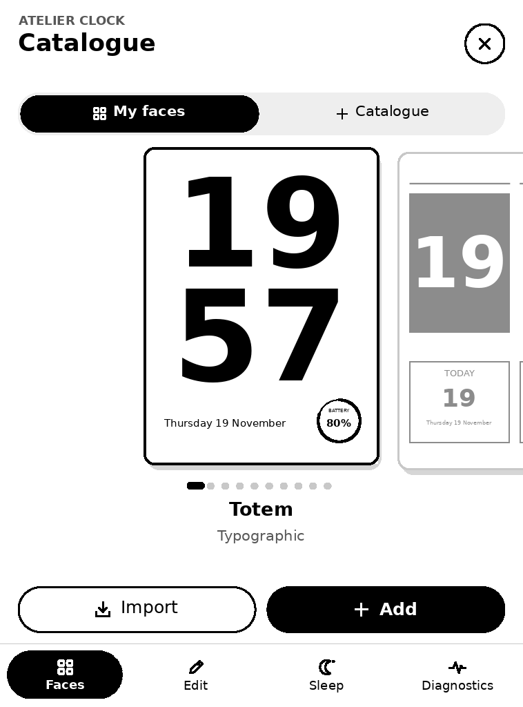
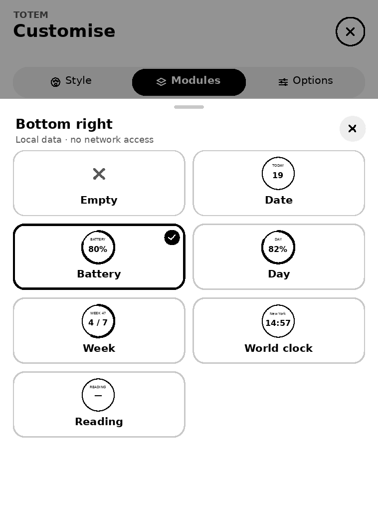
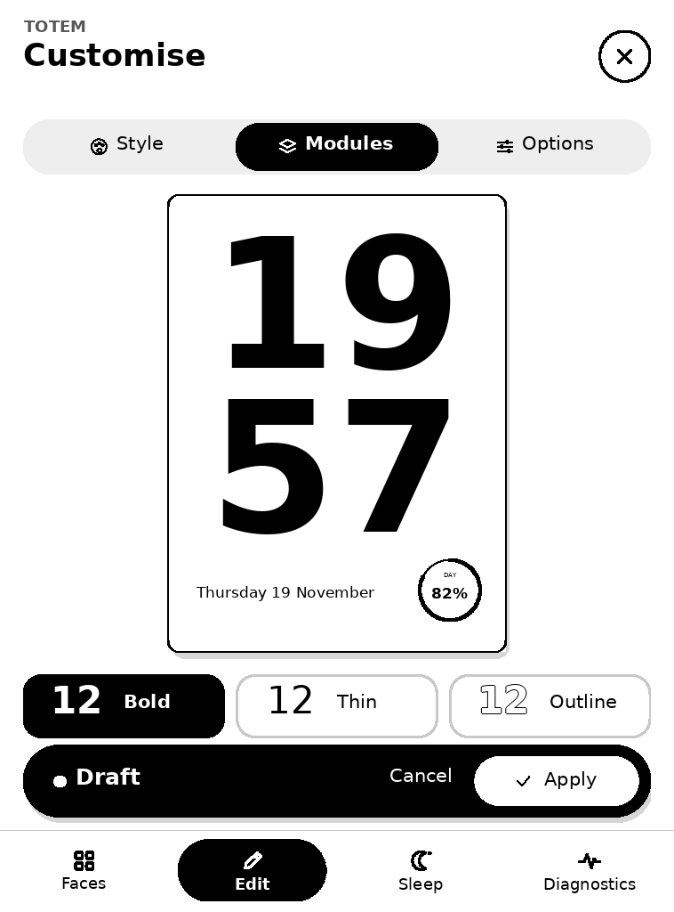
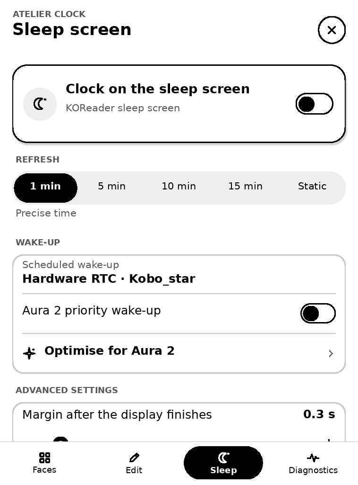

# Atelier Clock

**Sleep-screen clocks for KOReader, with a full-screen studio built for an e-reader that no longer refreshes at 2–3 Hz but at 30 Hz.**

Version **0.3.1 "Fluid"**, 19 November 2026 · [Changelog](CHANGELOG.md) · [Feature checklist](docs/FEATURES.md)


Atelier Clock shows a clock while your e-reader sleeps. The RTC wakes the reader up on a schedule to refresh it. A studio lets you pick, compose and tune ten clock faces.

Version 0.3.0 rebuilds the whole interface around the **Fluid Ink v6.5** engine:

- **Kobo Aura Edition 2 v1**: the engine targets **30 frames per second**, using the **Pulses 2** profile with the **Throughput** setting (*Impulsions 2* and *Débit* in Fluid Ink's own French labels).
- **Other Fluid Ink-compatible readers**: **Fluid Ink v6 without pulses**.
- **Every other device**: classic KOReader refresh, with exactly the same screens and features, minus the animation.

In the studio, scrolling follows your finger with momentum, screens slide, sheets rise from the bottom and switches flip with a small bounce, the way they do on a phone.

## See it move

Every frame below was rendered by the plugin's own code at 30 Hz, exactly as it would be handed to the engine (`tools/build_screenshots.py`, DejaVu fonts as substitutes). These are not videos of the e-ink panel.

| Inertial carousel | Tabs and counters |
| :---: | :---: |
|  |  |
| **Modules: sheet and flying frame** | **Settings: segments, elastic scrolling, draft** |
|  |  |

| "Show": the preview grows into the clock | What the panel gets: Bayer 8×8 dithering (simulation) |
| :---: | :---: |
|  |  |

## Screens

| Faces | Catalogue | Modules | Style |
| :---: | :---: | :---: | :---: |
|  |  |  |  |
| **Options** | **Sleep screen** | **Diagnostics** | **Actions** |
|  |  |  |  |


## What's new in 0.3.0

- **A hand-drawn interface.** Soft cards, pill buttons, segmented controls with a gliding pill, animated switches and 38 vector icons with rounded strokes. Solid black is kept for the main action.
- **Scrolling lists instead of numbered pages.** Scrolling has momentum and an elastic edge, and touching the screen stops it at once.
- **A face carousel.** Drag, fling, snap. Neighbouring faces peek in from the sides and fade with distance.
- **Bottom sheets** for modules, choices, actions (⋯) and confirmations. They replace KOReader dialogs, close with a downward swipe and never hand the screen back to KOReader.
- **A visible draft.** The *Draft · Cancel · Apply* bar appears only when there is something to apply. Messages show up as short toasts.
- **"Show" zooms** from the preview into the full-screen clock.
- **Every 10 minutes** joins the refresh choices: 1, 5, 10 or 15 minutes, or static.
- **English interface.** Every screen, message and menu is in English. The clock faces keep their own *Clock language* setting (English or French).
- **Built-in Fluid Ink 6.5 engine.** The profile is picked automatically for each reader (table below), with a clean fallback. **Diagnostics → Display** shows the active engine and its live rates.
- **RTC wake-up checked on every compatible reader**: 7 Kobo models and 3 Kindles. Kindle support (wake-up through powerd) is new.
- **Nothing removed.** See [docs/FEATURES.md](docs/FEATURES.md).

## Display engine

| Reader | Profile | Settings |
|---|---|---|
| **Kobo Aura Edition 2 v1** (`Kobo_star`) | **Fluid 30 Hz · Pulses 2** | Fluid Ink v6, 2 pulses, **Throughput** (queue 1, Bayer 8×8, no gamma), A2, 30 fps target |
| Kobo Aura 2 v2, Aura H2O 2 v1/v2, Glo HD, Aura One, Clara HD, Kindle Paperwhite 2/3, Voyage | **Fluid v6 · no pulses** | Vendor mode: A2 while moving, DU at rest, Throughput profile |
| Aura 2 v1 whose pulses are refused | **Fluid v6 · no pulses** | Fluid Ink v6; the fallback is shown in Diagnostics |
| Any other reader, or when the check fails | **Classic KOReader** | Same screens, each animation replaced by its final state |

How it works:

- The studio composes every frame in 8-bit greyscale from layers kept in memory (header, scrolling content, cards, sheets), then hands it to the engine.
- The engine runs in a separate process, after a RAM-only check that never touches the screen. While it runs, it is the only thing writing to the panel.
- For text entry (a name, an import or export path), the engine stops, restores the original waveform table and gives the screen back to KOReader, then resumes. The first frame after resuming may flash (GC16).
- Before every sleep, the engine is stopped synchronously, so the sleep-screen clock keeps its usual power path and never uses Fluid Ink.

Settings live in **Diagnostics → Display**:

| Setting | Values |
|---|---|
| Display engine | Automatic, Fluid or Classic |
| Target frame rate | 30, 45 or 60 Hz |
| Clean at rest | The engine's vendor refresh during pauses |
| Animations | Full or Reduced |

The same section has **Clean the screen** and **Retry the fluid engine**.

> **Pulses 2 on the Aura 2 v1.** The pulse profile needs the waveform copy `factory-reference.bin` from **your own** reader. It is a personal vendor file and this repository does not redistribute it. Copy it from your Fluid Ink 6.5 package (`inkmotion.koplugin/factory-reference.bin`) into `atelierclock.koplugin/engine/fluidink/`. Without it, the Aura 2 v1 switches to **Fluid v6 · no pulses** automatically.

If the engine stays off on a compatible reader, a toast and **Diagnostics → Display → Profile** give the reason, and `settings/atelierclock/fluid.log` records each decision. The worker always dies with KOReader, and any error closes the studio cleanly after releasing the engine.

Real smoothness, contrast and ghosting have to be measured on the panel (see `third_party/fluid-ink/PROTOCOLE_30HZ.md`). The Diagnostics counters report submitted frames and confirmed scans, not optical cadence.

## RTC wake-up by reader

| Reader | Wake-up | Notes |
|---|---|---|
| Kobo: `Kobo_star`, `Kobo_star_r2`, `Kobo_snow`, `Kobo_snow_r2`, `Kobo_alyssum`, `Kobo_daylight`, `Kobo_nova` | Hardware RTC (`WakeupMgr`), suspend handled by KOReader | The Aura 2 optimisations (priority wake-up, reused suspend preparation, FP9928 standby) stay limited to the models already targeted. On i.MX5 RTCs, the alarm chain of a long night pause is cleaned up on stop. |
| Kindle Paperwhite 2/3, Voyage | `WakeupMgr` + `mockrtc` through powerd | Needs the KOReader sleep screen (Kindles without special offers). powerd suspends the reader itself. A guard catches the minute if the reader stayed awake, or if a past alarm was dropped. About 15 s precision, so 5 minutes is recommended. |
| No `WakeupMgr` | None | The clock freezes when the reader sleeps, with an explicit message. |

These behaviours are tested against KOReader's own code (`wakeupmgr.lua`, `kindle/mockrtc.lua`, and the wake-up functions of `kindle/powerd.lua`), pinned to a specific commit. They were not measured on hardware.

## Installation

1. Quit KOReader.
2. Copy the **`atelierclock.koplugin`** folder into `koreader/plugins/`. On a Kobo this is usually `.adds/koreader/plugins/`.
   - When updating, **replace** the whole folder instead of merging it.
   - Keep `settings/atelierclock`: it holds your settings and your imported faces.
3. Aura 2 v1 only: add `factory-reference.bin` as described above.
4. Restart KOReader and open **Tools → More tools → Atelier Clock**.
5. In **Sleep**, turn on *Clock on the sleep screen*. The **Atelier clock** option is also available in KOReader's own sleep screen menu.

To run the clock by hand, use **Show** or the Dispatcher action *Atelier Clock: show the clock*. A tap closes it and a long press opens the studio. `.clock` faces (v1 and v2) are imported from the **Catalogue**, and any variant can be exported from **Edit → Options**.

## Development

The full guide is in [DEVELOPPEMENT.md](DEVELOPPEMENT.md), which is in French. The short version:

```bash
python -m pip install -r requirements-test.txt
```

```bash
python tools/fetch_test_dependencies.py
```

```bash
PYTHONPATH=tests python -m unittest discover -s tests -p 'test_*.py'
```

```bash
PYTHONPATH=tests python tools/build_screenshots.py
```

The suite has **171 tests**: rendering, power, RTC on all 10 models, the 10-minute profile, the simulated Fluid engine and animations on a deterministic clock. KOReader's plugin validator reports no errors.

## Licences

- **Atelier Clock code**: MIT.
- **Faces and textures**: CC0.
- **Fluid Ink engine** (`engine/fluidink`): its headers say GPL-3.0-or-later, and its package ships the AGPL-3.0 text. Its native sources are in `third_party/fluid-ink`.
- **The plugin as distributed** follows [LICENSE](LICENSE) (AGPL-3.0, as this repository did before).

Details are in `atelierclock.koplugin/LICENSE`.
